**[Français](#français)** · **[English](#english)** · **[Technologies](#technologies--tech-stack)** · **[Contact](#contact)**

## Français

Je construis des applications web, des API et des automatisations qui connectent les outils, les données et les services pour résoudre des problèmes concrets.

Développeur junior, je progresse à travers des projets réels. Je contribue actuellement à **Congo Libs**, un projet d'équipe. Je suis ouvert aux opportunités de stage, d'emploi et aux missions freelance.

### Ce sur quoi je travaille

- **Backend** : API REST avec Python, Django et Django REST Framework (authentification, rôles, documentation OpenAPI).
- **Automatisation** : workflows avec n8n et Make.com, intégrations d'API, expérimentations avec l'API OpenAI.
- **Frontend** : apprentissage de JavaScript, React et Next.js pour compléter mon profil full-stack.
- **Données et outils** : bases SQL, Git, Docker.

### Projet en cours

> #### Congo Libs
> Bibliothèque en ligne qui rassemble livres, sujets de concours et sujets d'examens, pour les retrouver et les télécharger facilement.
>
> **Fonctionnalités du backend**
> - Recherche par nom et filtres sur les documents (livres, concours, baccalauréat), avec suppression logique
> - Téléchargement de PDF stockés sur Google Drive, avec historique par utilisateur
> - Authentification par session pour le web, par token pour le mobile, et connexion Google
> - Espace d'administration avec rôles (`super_admin`, `editor`, `reader`)
> - Documentation Swagger/OpenAPI, CORS, limitation de débit, tests
>
> **Stack** : Python · Django · Django REST Framework · SQLite / PostgreSQL · Google Drive API · SMTP Brevo · React
>
> **Statut** : projet d'équipe, backend au stade MVP fonctionnel, en développement. Le code n'est pas encore public.

## English

I build web applications, APIs and automations that connect tools, data and services to solve concrete problems.

I'm a junior developer growing through real projects, and I currently contribute to **Congo Libs**, a team project. I'm open to internships, full-time roles and freelance work.

### What I'm working on

- **Backend**: REST APIs with Python, Django and Django REST Framework (authentication, roles, OpenAPI docs).
- **Automation**: workflows with n8n and Make.com, API integrations, experiments with the OpenAI API.
- **Frontend**: learning JavaScript, React and Next.js to round out my full-stack skills.
- **Data and tooling**: SQL databases, Git, Docker.

### Current project

> #### Congo Libs
> An online library that brings together books and past exam papers (university and school entrance exams, baccalauréat) so students can find and download them easily.
>
> **Backend features**
> - Search by name and filters across documents (books, entrance exams, baccalauréat), with soft delete
> - PDF downloads served from Google Drive, with per-user download history
> - Session authentication for web, token authentication for mobile, and Google sign-in
> - Admin area with roles (`super_admin`, `editor`, `reader`)
> - Swagger/OpenAPI docs, CORS, rate limiting, tests
>
> **Stack**: Python · Django · Django REST Framework · SQLite / PostgreSQL · Google Drive API · Brevo SMTP · React
>
> **Status**: team project, backend at a working MVP stage, under active development. The code is not public yet.

## Technologies / Tech stack

*Les technologies marquées « en apprentissage » sont celles que je suis en train d'apprendre. / Technologies marked "learning" are ones I'm currently learning.*

**Backend**

<table>
  <tr>
    <td align="center" width="90"> Python</td>
    <td align="center" width="90"> Django</td>
    <td align="center" width="90"> DRF</td>
  </tr>
</table>

**Frontend**

<table>
  <tr>
    <td align="center" width="90"> HTML</td>
    <td align="center" width="90"> CSS</td>
    <td align="center" width="90"> JavaScript en apprentissage / learning</td>
    <td align="center" width="90"> React en apprentissage / learning</td>
    <td align="center" width="90"> Next.js en apprentissage / learning</td>
  </tr>
</table>

**Bases de données et outils / Databases and tooling**

<table>
  <tr>
    <td align="center" width="90"> PostgreSQL</td>
    <td align="center" width="90"> Docker</td>
    <td align="center" width="90"> Git</td>
    <td align="center" width="90"> GitHub</td>
  </tr>
</table>

**Automatisation et IA / Automation and AI**

<table>
  <tr>
    <td align="center" width="90"> n8n</td>
    <td align="center" width="90"> Make.com</td>
    <td align="center" width="90"> OpenAI API</td>
  </tr>
</table>

## Contact

Un projet logiciel, une opportunité de stage ou d'emploi, une collaboration ? Écrivons-nous.
*A software project, an internship or job opportunity, a collaboration? Let's talk.*

- LinkedIn : [linkedin.com/in/ibeahomorel](https://www.linkedin.com/in/ibeahomorel)
- GitHub : [@ibeahomorel-ux](https://github.com/ibeahomorel-ux)
